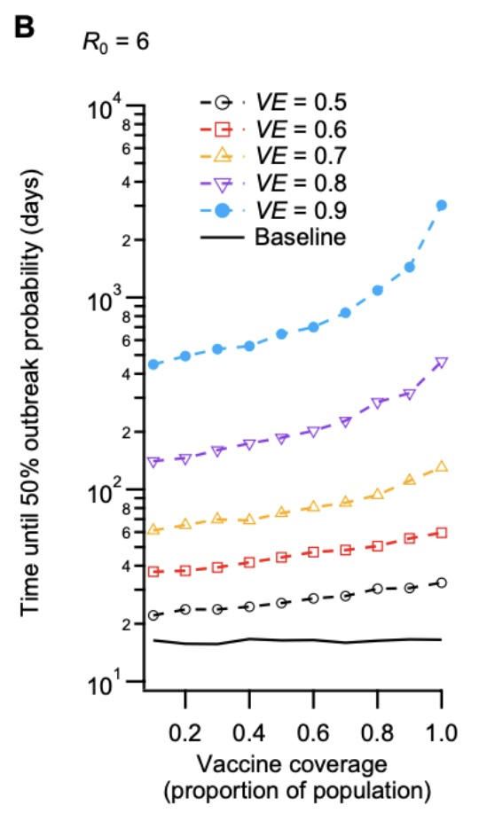

---
title: "Can Vaccination Alone Control COVID-19?"
author: "Kai-Hong Su"
date: "2026-10-12"
categories: [COVID-19, Public Health]
---

## Problem Description

During the COVID-19 pandemic, countries such as Australia and New Zealand used border quarantine to reduce the risk of infected travellers spreading the virus into local communities. As vaccines became available, there was hope that vaccination could reduce the need for strict quarantine measures.

However, the emergence of the more transmissible Delta variant raised an important question: **Could vaccination alone reduce the risk of COVID-19 spreading from quarantine facilities into communities, or were additional quarantine measures still necessary?**

A study by Zachreson et al. (2022) examined how virus transmissibility, vaccine effectiveness, and community vaccination coverage affected the risk of quarantine breaches and community outbreaks. Understanding these factors helps explain why vaccination and other infection control measures may need to work together.

## Analysis

### Why Does Virus Transmissibility Matter?

Not all COVID-19 variants spread at the same rate. The Delta variant was more transmissible than earlier variants, making it harder to prevent infections from spreading.

Zachreson et al. (2022) found that as the virus became more transmissible, higher vaccine effectiveness was needed to maintain the same level of quarantine breach risk. In their model, when the basic reproduction number increased from 3 to 6, vaccine effectiveness needed to exceed approximately 60%. When it increased to 8, the required effectiveness rose above 70%.

The basic reproduction number, often written as R0, describes how many people one infected person could infect on average in a fully susceptible population. A higher R0 means the virus can spread more easily.

These findings suggest that vaccination alone may become less reliable as more transmissible variants emerge, highlighting the importance of maintaining other infection control measures.

@tbl-vaccine summarises how the vaccine effectiveness required to maintain a similar quarantine breach risk increases with virus transmissibility.

| Basic reproduction number (R0) | Approximate vaccine effectiveness required |
|:-------------------------------|:-------------------------------------------|
| 6                              | Above 60%                                  |
| 8                              | Above 70%                                  |

: Vaccine effectiveness required to maintain a similar quarantine breach risk under the study's model assumptions. Source: Zachreson et al. (2022). {#tbl-vaccine}

### Does Higher Vaccination Coverage Reduce Outbreak Risk?

Vaccine effectiveness is not the only factor that influences the risk of a COVID-19 outbreak. Vaccination coverage, which refers to the proportion of people in a community who have been vaccinated, also plays an important role.

Zachreson et al. (2022) found that higher community vaccination coverage could delay the occurrence of an outbreak following a quarantine breach. This is because vaccination can reduce the likelihood of the virus spreading through the community.

However, higher vaccination coverage does not necessarily eliminate the risk of an outbreak. The level of protection also depends on vaccine effectiveness and how easily the virus spreads.

These findings suggest that vaccination is an important part of controlling COVID-19, but additional measures may still be necessary, particularly when more transmissible variants emerge.

As shown in @fig-vaccination, higher vaccination coverage
generally increases the modelled time until a community outbreak,
particularly when vaccine effectiveness is high.

{#fig-vaccination width="35%" fig-align="center"}

For example, the blue line (90% vaccine effectiveness) rises much more sharply than the black dashed line (50% vaccine effectiveness) as vaccination coverage increases. This suggests that higher vaccination coverage is more effective at delaying outbreaks when vaccines provide stronger protection.

However, the findings are based on a simulation model, and vaccination does not completely eliminate the risk of an outbreak. Therefore, vaccination alone may not be sufficient to control COVID-19, and additional infection control measures, such as effective quarantine procedures, are still important.

## Conclusion

The findings suggest that vaccination alone may not be sufficient to control COVID-19, particularly when more transmissible variants emerge. Although higher vaccine effectiveness and community vaccination coverage can delay outbreaks, they do not completely eliminate the risk of the virus spreading into communities.

The study by Zachreson et al. (2022) also highlights that more transmissible variants require stronger vaccine protection to maintain a similar level of quarantine breach risk. Therefore, vaccination should be combined with other infection control measures, such as effective border quarantine procedures, to reduce the risk of community outbreaks.

## References

Zachreson, C., Shearer, F. M., Price, D. J., Lydeamore, M. J., McVernon, J., McCaw, J., & Geard, N. (2022). COVID-19 in low-tolerance border quarantine systems: Impact of the delta variant of SARS-CoV-2. Science Advances, 8(14). <https://doi.org/10.1126/sciadv.abm3624>

